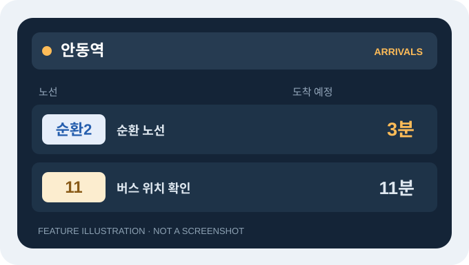
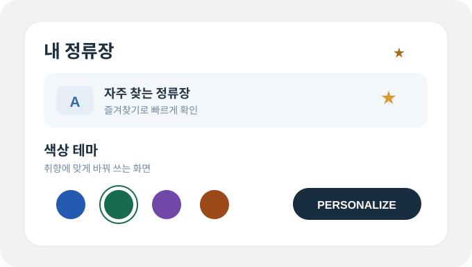

<div align="right">

**한국어** · [English](README.md)

</div>

<p align="center">
  
</p>

<p align="center">
  <a href="https://github.com/homesweetlove/YeaAnBus-OpenSource/actions/workflows/android.yml"></a>
  
  
  
  <a href="LICENSE"></a>
</p>

# 예안버스 — 지역 버스 정보를 한눈에

**YeaAnBus(예안버스)** 는 **안동·예천** 지역의 정류장, 노선, 도착 예정 정보, 버스 위치를 확인하기 위해 만든 Android 프로젝트입니다.

두 지역을 한 번에 검색하고, 도착 정보는 읽기 쉽게, 자주 이용하는 정류장은 빠르게 찾아볼 수 있도록 구성했습니다.

> **포트폴리오용 오픈소스 공개본**입니다. 아래 이미지는 실제 앱 화면이나 실시간 버스 데이터가 아닌 **기능 소개용 일러스트**입니다. 개인 API 키, 서명 정보, 비공개 APK는 포함하지 않았으며 Android 실기기 검증은 아직 완료되지 않았습니다.

## 주요 화면과 기능

<table>
  <tr>
    <td width="33%" align="center"></td>
    <td width="33%" align="center"></td>
    <td width="33%" align="center"></td>
  </tr>
  <tr>
    <td><strong>도착 안내</strong><br/>노선과 도착 예정 정보를 알아보기 쉬운 형태로 확인합니다.</td>
    <td><strong>지도와 버스 위치</strong><br/>정류장·노선·차량의 위치를 지도에서 살펴봅니다.</td>
    <td><strong>나만의 이용 환경</strong><br/>즐겨찾기 정류장과 테마 설정으로 반복 이용을 편하게 만듭니다.</td>
  </tr>
</table>

### 지역 이동에 필요한 기능

- **통합 검색** — 안동·예천 정류장과 노선을 지역 선택 없이 검색하고, 주변 정류장을 거리순으로 표시합니다.
- **실제 데이터 중심** — 안동 BIS와 승인된 TAGO 데이터로 조회하며, 실패 시 원인을 안내하고 임의 데이터를 생성하지 않습니다.
- **갱신·위치 처리** — GPS 필터링, 도착 시간 추정 보조 로직, 캐시, 조회 간격 제어를 적용했습니다.
- **개인화** — 즐겨찾기, 출퇴근 중심 화면, 위젯, 밝은/어두운 화면 및 색상 테마를 제공합니다.

## 기술 구성

| 구분 | 기술 |
| --- | --- |
| 앱 | Kotlin · Jetpack Compose · Material 3 · MVVM |
| 통신 | Retrofit · OkHttp · Coroutines / Flow |
| 저장 및 백그라운드 | Room · SharedPreferences · WorkManager |
| 지도 | NAVER Maps Android SDK |
| 검증 | Android CI · 단위 테스트 · Android Lint |

## 직접 실행하기

1. Android Studio에서 저장소를 열고 Android SDK Platform 35, **JDK 17 또는 21**을 준비합니다.
2. API 키 없이도 프로젝트 빌드와 안동 BIS 연동 코드 확인이 가능합니다.
3. 예천/TAGO 조회를 사용하려면 `app/src/keyTemplate/java/kr/yeaan/bus/config/ApiKeys.kt`를 `app/src/main/java/kr/yeaan/bus/config/ApiKeys.kt`로 복사하고, 본인의 **TAGO Decoding 키**를 입력합니다.
4. 지도 기능을 사용하려면 로컬 `local.properties`에 `NAVER_MAP_CLIENT_ID`를 설정하고 네이버 Maps 프로젝트에 Android 패키지 `kr.yeaan.bus`를 등록합니다.
5. Android 8.0(API 26) 이상 기기나 에뮬레이터에서 실행합니다.

```bash
./gradlew assembleDebug testDebugUnitTest lintDebug
```

Windows: `.\gradlew.bat assembleDebug testDebugUnitTest lintDebug`

**주의:** 앱에 삽입한 API 키는 APK 분석으로 추출될 수 있습니다. 개인 키가 포함된 APK는 공개하면 안 됩니다. 이 저장소에는 설치용 공개 APK가 없으며, 예천/TAGO 조회는 승인받은 키가 필요합니다.

## 문서

- [상세 기술 문서](docs/TECHNICAL.ko.md) — API 설정·데이터 연동·아키텍처·지도·위젯
- [검증 기록](docs/VALIDATION.md) — 테스트 이력과 남은 실기기 검증
- [배포 체크리스트](docs/RELEASE.md) — 릴리스 준비 항목
- [보안 정책](SECURITY.md) · [MIT 라이선스](LICENSE)

<p align="center"><sub>안동과 예천 사이의 이동을 조금 더 편하게 · Open-source code showcase</sub></p>
