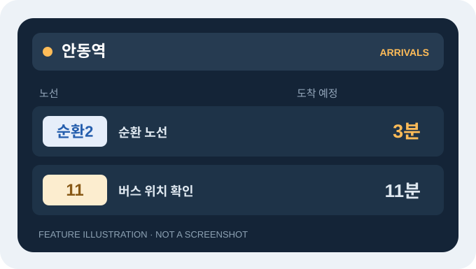
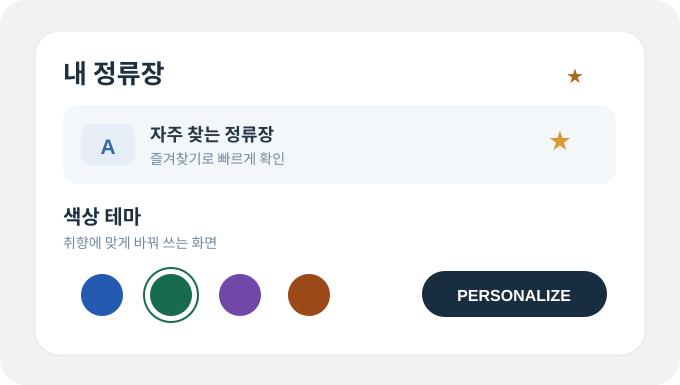

<div align="right">

[한국어](README.ko.md) · **English**

</div>

<p align="center">
  
</p>

<p align="center">
  <a href="https://github.com/homesweetlove/YeaAnBus-OpenSource/actions/workflows/android.yml"></a>
  
  
  
  <a href="LICENSE"></a>
</p>

# YeaAnBus — everyday transit, made clearer

**YeaAnBus (예안버스)** is an Android project for exploring bus stops, routes, arrival estimates, and vehicle positions across **Andong and Yecheon, South Korea**.

One search, two regions. Designed around a legible arrival board, a useful map, and the stops you return to every day.

> **Open-source portfolio edition.** The images below are **illustrations**, not actual device screenshots or live arrival data. The repository deliberately excludes personal API keys, signing credentials, and private APKs. Real-device validation is still pending.

## At a glance

<table>
  <tr>
    <td width="33%" align="center"></td>
    <td width="33%" align="center"></td>
    <td width="33%" align="center"></td>
  </tr>
  <tr>
    <td><strong>Arrivals at a glance</strong><br/>Route information and upcoming buses in a clear, glanceable layout.</td>
    <td><strong>Map with context</strong><br/>Inspect stops, routes, and vehicle positions in a map-focused flow.</td>
    <td><strong>Made personal</strong><br/>Save frequent stops and choose a visual theme that suits you.</td>
  </tr>
</table>

### Built for local journeys

- **Unified regional search** — find Andong and Yecheon stops and routes together; nearby stops are merged and sorted by distance.
- **Live-data discipline** — Andong BIS and, when authorized, TAGO sources; explicit fallback and error states rather than invented transport data.
- **Thoughtful refresh behavior** — GPS filtering, arrival prediction helpers, cache reuse, and rate-aware polling.
- **Everyday convenience** — favorites, commute-oriented views, widgets, and light/dark appearance options.

## Technology

| Layer | Implementation |
| --- | --- |
| Application | Kotlin · Jetpack Compose · Material 3 · MVVM |
| Networking | Retrofit · OkHttp · Coroutines / Flow |
| Local data | Room · SharedPreferences · WorkManager |
| Maps | NAVER Maps Android SDK |
| Quality | Android CI · Unit tests · Android Lint |

## Run it locally

1. Open this repository in **Android Studio** with Android SDK Platform 35 and **JDK 17 or 21**.
2. Build with no credentials to explore the code and the available Andong BIS integration.
3. To enable authorized TAGO requests, copy `app/src/keyTemplate/java/kr/yeaan/bus/config/ApiKeys.kt` into `app/src/main/java/kr/yeaan/bus/config/ApiKeys.kt`, then replace the placeholder with **your own** TAGO decoding key.
4. For NAVER Maps, set `NAVER_MAP_CLIENT_ID` in your **local** `local.properties` and register the Android package `kr.yeaan.bus` in your NAVER Maps project.
5. Run the Android app on an API 26+ device or emulator.

```bash
./gradlew assembleDebug testDebugUnitTest lintDebug
```

Windows: `.\gradlew.bat assembleDebug testDebugUnitTest lintDebug`

**Important:** Android client-side credentials can still be extracted from an APK. Do not publish a binary containing personal keys. This repository does **not** offer a distributable APK or promise working Yecheon data without an authorized key.

## Project notes

- [Technical guide](docs/TECHNICAL.md) — API setup, architecture, refresh logic, maps, widgets and known limitations
- [Validation notes](docs/VALIDATION.md) — recorded checks and remaining device testing
- [Release checklist](docs/RELEASE.md) — release/readiness details
- [Security policy](SECURITY.md) · [MIT license](LICENSE)

<p align="center"><sub>Designed for the roads between Andong and Yecheon · Open-source code showcase</sub></p>
